# Role Blueprint: BigQuery SQL & Slot Cost Optimizer

This document serves as the architectural reference and companion guide to the [`clusters/bq-sql-optimizer.json`](./bq-sql-optimizer.json) cluster definition.

---

## 1. Role Definition: BigQuery SQL & Slot Cost Optimizer

A **BigQuery SQL & Slot Cost Optimizer** (`bq-sql-optimizer`) is a specialized data performance and FinOps engineering persona focused on diagnosing, grouping, classifying, and refactoring high-consumption BigQuery SQL workloads.

Unlike a generalist **Data Engineer** (who builds end-to-end ingestion pipelines across Spark, Dataflow, and Airflow) or a **Cloud Data Enterprise Architect** (who designs organization-wide data meshes, IAM perimeters, and landing zones), the **BigQuery SQL & Slot Cost Optimizer** operates with surgical precision on query execution efficiency, slot-time reduction, and physical table layout (partitioning and clustering). Crucially, this role is designed to operate in **offline/static audit environments**—starting directly from exported job telemetry (CSV or Google Sheets of top slot-consuming jobs) and local schema/SQL definitions without requiring live production database connections.

### Architecture Topology Diagram

```mermaid
flowchart LR
    subgraph InputSources["1. Offline Telemetry & Schema Inputs"]
        direction TB
        CSV["Top Consumer Jobs Export<br>(CSV / Google Sheet: slot_ms, bytes)"]
        LocalDDL["Local Table Schemas & DDL<br>(Partition / Cluster Metadata)"]
    end

    subgraph GroupingEngine["2. Workload Fingerprinting & Grouping"]
        direction TB
        DestGroup["Destination Table Grouping<br>(Shared Target Tables / Views)"]
        ASTGroup["SQL Structural Fingerprinting<br>(Literal Normalization & AST Clustering)"]
    end

    subgraph Classification["3. Anti-Pattern Classification Engine"]
        direction TB
        ScanIssues["Scan & Pruning Anti-Patterns<br>(SELECT *, Missing/Wrapped Partition Filters)"]
        JoinIssues["Join & Compute Anti-Patterns<br>(Cross/Exploding Joins, Correlated Subqueries)"]
        DAGIssues["DAG & Materialization Issues<br>(Repeated CTE Scans, Late Aggregation)"]
    end

    subgraph Remediation["4. End-to-End Remediation & Deliverables"]
        direction TB
        EnrichedSheet["Enriched CSV / Google Sheet<br>(Group IDs, Classifications, Impact)"]
        RefactoredSQL["Refactored SQL & DDL Scripts<br>(Partitioning, Clustering, Rewrites)"]
        ExecReport["Executive & Technical Report<br>(Markdown / Google Doc Before & After)"]
    end

    InputSources --> GroupingEngine
    GroupingEngine --> Classification
    Classification --> Remediation
```



### Core Architectural Pillars

1. **Offline Job Telemetry Ingestion & Pareto Profiling**:
   - Ingesting static job history exports (CSV or Google Sheets) extracted from `INFORMATION_SCHEMA.JOBS_BY_PROJECT` or billing exports.
   - Profiling workload distribution using Pareto analysis (identifying the top 20% of query patterns responsible for 80%+ of `total_slot_ms` and `total_bytes_billed`).
   - Interpreting stage-level telemetry indicators present in exports (`shuffle_output_bytes_spilled`, `wait_ratio_avg`, `records_read` vs. `records_written`, `slot_contention`).

2. **Workload Fingerprinting, SQL Similarity Grouping & Lineage Impact**:
   - Grouping individual job executions into canonical **Query Families** based on shared `destination_table`, source table footprint, and normalized SQL structure (stripping date literals, `IN` lists, and temporary table suffixes).
   - Consolidating recurring scheduled queries, BI dashboard refreshes, and parameterized dbt/Dataform runs so optimization effort is multiplied across hundreds of daily executions.
   - Assessing downstream blast radius and lineage dependencies before modifying target table schemas or view definitions.

3. **Taxonomy-Driven Anti-Pattern Classification**:
   - Systematically classifying each job and query group against canonical BigQuery optimization issues:
     - **Projection & Column Pruning**: `SELECT *`, `SELECT * EXCEPT(...)` over wide tables, unnecessary `STRUCT`/`JSON` extraction.
     - **Partition Pruning Failures**: Missing partition filters on large tables, non-SARGable predicates (applying `DATE()`, `CAST()`, `EXTRACT()`, or string functions directly to the partition column), or dynamic subquery filters that defeat static pruning.
     - **Clustering Underutilization**: Filtering or sorting on non-clustered columns, or violating leading cluster key order.
     - **Join & Shuffle Bottlenecks**: Unfiltered large-to-large joins, N:M exploding joins, skewed join keys, and `WHERE col IN (SELECT ...)` instead of `EXISTS`.
     - **CTE & Aggregation Inefficiencies**: Referenced CTEs evaluated multiple times without materialization, late `GROUP BY` after joins, `UNION` instead of `UNION ALL`, and exact `COUNT(DISTINCT)` where `APPROX_COUNT_DISTINCT` suffices.

4. **SQL Refactoring & Storage Layout Tuning (DDL)**:
   - Rewriting SQL queries for maximum slot and scan efficiency (early predicate pushdown, early aggregation, column pruning, intermediate table materialization).
   - Designing optimal `PARTITION BY` (time-unit or integer-range) and `CLUSTER BY` (up to 4 high-cardinality filter/join columns) DDL specifications, including `require_partition_filter = true`.
   - Translating query optimizations into maintainable transformation models (`dbt-bigquery` and `dataform-bigquery`).

5. **Deliverable Packaging & Safe Migration Governance**:
   - Enriching the source CSV or Google Sheet with group identifiers, standardized anti-pattern tags, severity tiers, and remediation summaries.
   - Generating comprehensive Executive & Technical Optimization Reports (Markdown or Google Docs) with side-by-side before/after SQL comparisons and expected slot savings.
   - Enforcing strict data-loss prevention guardrails on all generated DDL/DML migration scripts.

---

## 2. Skill Breakdown by Competency

The [`bq-sql-optimizer`](./bq-sql-optimizer.json) cluster bundles **12 skills** and **0 plugins** mapped directly to the core architectural pillars:

| Competency Domain | Skill / Plugin Identifier | Architectural Rationale | Provenance Source |
| :--- | :--- | :--- | :--- |
| **Telemetry & Pareto Profiling** | `bigquery-slot-cost-optimizer` | Provides slot consumption heuristics, cost formulas, and decision trees (`Rule SLOT-001`, `Rule JOIN-001`, `Rule PART-001`) plus offline telemetry analysis patterns. | `external/googlecloud-base/cloud` |
| | `bigquery-observability` | Supplies authoritative schema dictionaries (`schema_compute.md`, `schema_storage.md`) for interpreting `INFORMATION_SCHEMA.JOBS*` and `TABLE_STORAGE*` columns in CSV/Sheet exports. | `external/googlecloud-base/cloud` |
| **Workload Grouping & Lineage** | `datalineage-bigquery-asset-impact-analysis` | Evaluates downstream blast radius when refactoring shared destination tables, views, or partition keys identified during job grouping. | `external/googlecloud-base/cloud` |
| | `datalineage-summary` | Summarizes upstream source-to-target transformation flows across grouped SQL jobs. | `external/googlecloud-base/cloud` |
| **Anti-Pattern Diagnosis** | `bigquery-troubleshooting` | Provides the 4-step cost diagnostic funnel and root-cause analysis workflows for execution graph bottlenecks, shuffle spills, and data skew. | `external/googlecloud-base/cloud` |
| **SQL Refactoring & DDL Tuning** | `bigquery-sql` | Enforces concrete BigQuery SQL rewrite rules: column pruning, common subexpression reuse, predicate pushdown, early aggregation, and `IN` to `EXISTS` conversion. | `external/googlecloud-data` |
| | `bigquery-optimization` | Guides table partitioning and clustering DDL design, `require_partition_filter` enforcement, physical vs. logical storage billing evaluation, and SQL tuning. | `external/googlecloud-base/cloud` |
| | `dbt-bigquery` | Applies SQL, incremental strategy, and partition/cluster optimizations directly to modular dbt BigQuery models. | `external/googlecloud-data` |
| | `dataform-bigquery` | Applies SQLX refactoring, assertion tuning, and incremental partition pruning to Dataform pipelines. | `external/googlecloud-data` |
| **FinOps & WAF Alignment** | `google-cloud-waf-cost-optimization` | Aligns query and storage optimization recommendations with Google Cloud Well-Architected Framework FinOps principles. | `external/googlecloud-base/cloud` |
| | `google-cloud-waf-performance-optimization` | Grounds compute and query tuning recommendations in Google Cloud WAF performance standards. | `external/googlecloud-base/cloud` |
| **Safety Guardrails** | `accidental-data-loss-prevention` | Ensures generated DDL/DML migration scripts (such as table repartitioning via CTAS or `CREATE OR REPLACE TABLE`) include verification safeguards against data loss. | `external/googlecloud-data` |

---

## 3. Missing Skills Analysis (Catalog Gaps)

While the upstream catalog provides strong foundational rules for individual BigQuery SQL rewrites (`bigquery-sql`), DDL partitioning (`bigquery-optimization`), and slot heuristics (`bigquery-slot-cost-optimizer`), it assumes interactive `gcloud`/`bq` CLI access and single-query analysis. To support **automated, batch-scale offline optimization from CSV/Google Sheets**, the following capability gaps exist and are recommended for creation in `internal/data-platform/skills/`:

```
┌──────────────────────────────────────────────────────────────────────────────────────┐
│                          Catalog Gap Scaffolding Roadmap                             │
├──────────────────────────────────────────────────────────────────────────────────────┤
│ 1. bq-job-csv-sheets-profiler         → Offline CSV/Sheets ingestion & Pareto rank   │
│ 2. bq-sql-similarity-grouper          → SQL AST fingerprinting & destination grouping│
│ 3. bq-sql-antipattern-classifier      → Multi-label SQL anti-pattern rule engine     │
│ 4. bq-optimization-report-packager    → Enriched CSV/Sheet, SQL files & Exec Report  │
└──────────────────────────────────────────────────────────────────────────────────────┘
```

| Missing Skill | Critical Enterprise Capability | Recommended Implementation Path |
| :--- | :--- | :--- |
| **`bq-job-csv-sheets-profiler`** | Offline ingestion, column normalization, and Pareto slot/cost profiling of top BigQuery consumer jobs from CSV files or Google Sheets. | Scaffold in `internal/data-platform/skills/bq-job-csv-sheets-profiler` (`agyhub create skill bq-job-csv-sheets-profiler -g data-platform`) with Python CSV/Sheets parsing scripts. |
| **`bq-sql-similarity-grouper`** | Automated clustering of BigQuery jobs into Query Families based on destination tables, source table sets, normalized literals, and SQL AST similarity. | Scaffold in `internal/data-platform/skills/bq-sql-similarity-grouper` (`agyhub create skill bq-sql-similarity-grouper -g data-platform`) with SQL tokenizer/fingerprinting utilities. |
| **`bq-sql-antipattern-classifier`** | Deterministic, multi-label static analyzer that classifies SQL queries against a standardized taxonomy (`SELECT *`, partition filter misuse, exploding joins, repeated CTEs, etc.). | Scaffold in `internal/data-platform/skills/bq-sql-antipattern-classifier` (`agyhub create skill bq-sql-antipattern-classifier -g data-platform`) with regex/AST rule definitions and severity scoring. |
| **`bq-optimization-report-packager`** | End-to-end deliverable generator producing enriched CSV/Sheets, organized refactored `.sql`/DDL workspace scripts, and Executive & Technical Markdown/Google Doc reports. | Scaffold in `internal/data-platform/skills/bq-optimization-report-packager` (`agyhub create skill bq-optimization-report-packager -g data-platform`) with report & diff templates. |

### Gap Details & Blueprint Specifications

#### 1. `bq-job-csv-sheets-profiler`
- **Architectural Need**: Existing BigQuery skills default to querying live `INFORMATION_SCHEMA.JOBS_BY_PROJECT` via `bq` CLI. In consulting, auditing, and restricted enterprise workspaces, engineers receive static CSV exports or Google Sheets of top slot-consuming jobs. The agent needs a deterministic workflow to ingest these exports without attempting live GCP connections.
- **Key Capabilities**:
  - Auto-detecting and mapping varied CSV/Google Sheet column schemas (`job_id`, `query`, `total_slot_ms`, `total_bytes_billed`, `creation_time`, `destination_table`, `referenced_tables`, `user_email`, `statement_type`).
  - Computing derived FinOps metrics offline: Slot-Hours (`total_slot_ms / 3,600,000`), TiB Billed, % of total workload slot time, and cumulative Pareto rank.
  - Filtering out noise (`SCRIPT` parent wrappers to avoid double-counting, cached queries, trivial metadata lookups) and handling truncated or multi-line SQL strings safely.
- **Recommended Implementation Blueprint**: Author in `internal/data-platform/skills/bq-job-csv-sheets-profiler/SKILL.md` with a zero-dependency Python helper script (`scripts/profile_jobs_csv.py`) that validates CSV/TSV inputs and outputs a normalized JSON/CSV profile.

#### 2. `bq-sql-similarity-grouper`
- **Architectural Need**: A top-consumers CSV export often contains hundreds of executions of the same underlying template query (e.g., hourly scheduled queries, Looker PDTs, or Airflow tasks with different date literals or temp table names) or multiple variations writing to the same destination table. Optimizing jobs one by one wastes effort and produces repetitive reports.
- **Key Capabilities**:
  - **Literal & Identifier Normalization**: Stripping comments, standardizing whitespace/casing, replacing string/date/numeric literals with placeholders (`?`), and normalizing temporary/staging table suffixes (`_temp_20261012` -> `_temp_<DATE>`).
  - **Multi-Tier Grouping Strategy**:
    1. *Exact Normalized Fingerprint*: Identical normalized SQL structure.
    2. *Destination Table Cohort*: Queries targeting the same `project.dataset.table` destination.
    3. *Structural & Source Similarity*: Token/AST Jaccard similarity clustering for ad-hoc queries scanning the same core fact tables.
  - **Group-Level Rollup**: Aggregating execution count, total `slot_ms`, average `slot_ms`, max `bytes_billed`, and selecting a representative canonical SQL query for each group.
- **Recommended Implementation Blueprint**: Author in `internal/data-platform/skills/bq-sql-similarity-grouper/SKILL.md` with a Python grouping script (`scripts/group_similar_sqls.py`) using standard-library `difflib` / regex tokenization.

#### 3. `bq-sql-antipattern-classifier`
- **Architectural Need**: Current catalog skills explain how to rewrite a single query, but lack a structured, machine-readable classification taxonomy to tag and score hundreds of jobs systematically based on static SQL text and local schema/DDL metadata.
- **Key Capabilities**:
  - **Standardized Anti-Pattern Taxonomy**:
    - `AP-PROJ-01` (`SELECT_STAR`): Root or CTE `SELECT *` preventing columnar projection pruning.
    - `AP-PART-01` (`MISSING_PARTITION_FILTER`): Querying a partitioned table without a `WHERE` filter on the partition column.
    - `AP-PART-02` (`NON_SARGABLE_PARTITION_FILTER`): Wrapping a partition column in a function (`DATE(ts_col) = ...`, `FORMAT_DATE(...)`, `CAST(...)`) or comparing against a dynamic subquery that prevents static pruning.
    - `AP-CLUST-01` (`CLUSTER_KEY_MISALIGNMENT`): Filtering/joining without leveraging leading cluster columns or recommending new `CLUSTER BY` keys based on frequent predicates.
    - `AP-JOIN-01` (`UNFILTERED_OR_EXPLODING_JOIN`): `CROSS JOIN`, missing join predicates, joining before filtering/aggregating, or `STRING` / `CAST` join keys.
    - `AP-SUBQ-01` (`IN_OR_CORRELATED_SUBQUERY`): Using `WHERE col IN (SELECT ...)` or `WHERE (SELECT COUNT(*)...) > 0` instead of `EXISTS` / `SEMI JOIN`.
    - `AP-CTE-01` (`REPEATED_CTE_EVALUATION`): Referencing a complex CTE multiple times causing BigQuery to re-execute the subgraph repeatedly.
    - `AP-AGG-01` (`EXPENSIVE_DEDUP_OR_DISTINCT`): Using `SELECT DISTINCT` or `UNION` instead of `UNION ALL`, `ORDER BY` in subqueries, or `ROW_NUMBER() OVER (...) = 1` without `QUALIFY` or `ARRAY_AGG(..., LIMIT 1)`.
  - Cross-referencing parsed SQL tables/columns against local workspace DDL/schema definitions (when provided) to verify partition/cluster column usage.
  - Outputting structured classification codes, human-readable explanations, severity ratings (`CRITICAL`, `HIGH`, `MEDIUM`, `LOW`), and estimated slot impact per job and group.
- **Recommended Implementation Blueprint**: Author in `internal/data-platform/skills/bq-sql-antipattern-classifier/SKILL.md` with a comprehensive rulebook (`references/antipattern_catalog.md`) and static analyzer script (`scripts/classify_sql_antipatterns.py`).

#### 4. `bq-optimization-report-packager`
- **Architectural Need**: To complete the end-to-end offline workflow, the agent must transform its grouping, classification, and SQL refactoring outputs into the three concrete deliverables expected by stakeholders.
- **Key Capabilities**:
  - **Enriched CSV / Google Sheet Generation**: Appending standardized columns (`group_id`, `group_name`, `destination_table_normalized`, `antipattern_codes`, `primary_issue_category`, `severity`, `optimization_recommendation`, `refactored_sql_file`) to the original job list while preserving all original rows and metrics.
  - **Workspace SQL & DDL Artifact Organization**: Writing clean, well-commented before/after `.sql` files and DDL migration scripts (`sql_optimizations/group_<id>_<name>.sql`, `ddl_recommendations/<table_name>_ddl.sql`) with header blocks documenting the anti-patterns fixed.
  - **Executive & Technical Report Synthesis**: Generating a structured Markdown (or Google Doc via `gdocs`) report featuring an Executive Pareto Summary, Top Query Groups Breakdown, Anti-Pattern Distribution Matrix, Side-by-Side SQL Diffs, and Prioritized Implementation Roadmap.
- **Recommended Implementation Blueprint**: Author in `internal/data-platform/skills/bq-optimization-report-packager/SKILL.md` with standardized Markdown report templates (`resources/executive_report_template.md`) and CSV enrichment utilities.
