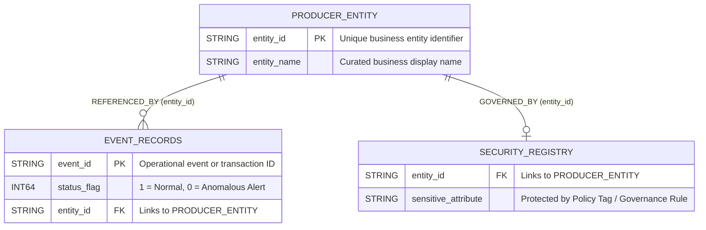
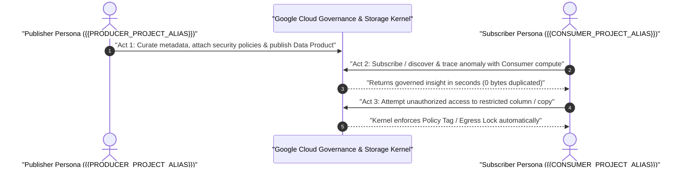

# Live Demo Guide & Visual Walkthrough: {{DEMO_TITLE}}

**Document Version**: 1.0.0  
**Target Google Cloud Services**: {{TARGET_GCP_SERVICES}}  
**Logical Demo Topology**:
- **Producer / Source Plane**: `{{PRODUCER_PROJECT_ALIAS}}` (`{{SOURCE_DATASET_ALIAS}}`, Location: `{{BQ_LOCATION}}`)
- **Consumer / Analytics Plane**: `{{CONSUMER_PROJECT_ALIAS}}` (`{{CONSUMER_DATASET_ALIAS}}`, Location: `{{BQ_LOCATION}}`)

**Domain Mapping**: **{{DOMAIN_ID}}** (`{{DOMAIN_NAME}}`)  
**Related Deliverables**: [`project_challenges.md`](../../../../../common/project_challenges.md) · [`project_questions-log.md`](../../../../../common/project_questions-log.md)

---

## 1. Executive Summary & Demo Storyline

{{EXECUTIVE_SUMMARY_PARAGRAPH}}

### 1.1 Architectural Capabilities Demonstrated Live

| # | Architectural Capability | What Happens Live in the Demo | Why It Matters for {{CUSTOMER_NAME}} |
| :---: | :--- | :--- | :--- |
| **1** | **{{CAPABILITY_1_TITLE}}** | {{CAPABILITY_1_DEMO_ACTION}} | {{CAPABILITY_1_BUSINESS_VALUE}} |
| **2** | **{{CAPABILITY_2_TITLE}}** | {{CAPABILITY_2_DEMO_ACTION}} | {{CAPABILITY_2_BUSINESS_VALUE}} |
| **3** | **{{CAPABILITY_3_TITLE}}** | {{CAPABILITY_3_DEMO_ACTION}} | {{CAPABILITY_3_BUSINESS_VALUE}} |
| **4** | **{{CAPABILITY_4_TITLE}}** | {{CAPABILITY_4_DEMO_ACTION}} | {{CAPABILITY_4_BUSINESS_VALUE}} |

### 1.2 End-to-End Architecture Flow


---

## 2. Domain Storyline, Entities & Customer Parallel

### 2.1 The Story Hook: {{STORY_HOOK_TITLE}}

- **The Demo Mystery / Scenario**: {{STORY_SCENARIO_SUMMARY}}
- **The Planted Anomaly / Trigger**: {{STORY_ANOMALY_SUMMARY}}
- **Real-World Parallel at {{CUSTOMER_NAME}}**: {{CUSTOMER_PARALLEL_SUMMARY}}

### 2.2 Entity-Relationship & Governance Model



### 2.3 Curated Data Product Inventory

| Asset Name | Type | Records | Governance Control | Curated Business Description |
| :--- | :--- | :---: | :--- | :--- |
| **`{{TABLE_1}}`** | `BASE TABLE` | `{{ROW_COUNT_1}}` | {{GOV_1}} | {{DESC_1}} |
| **`{{TABLE_2}}`** | `BASE TABLE` | `{{ROW_COUNT_2}}` | {{GOV_2}} | {{DESC_2}} |

---

## 3. Act-by-Act GCP Console Walkthrough & Live Screenshots



### 3.1 Act 1 ({{ACT_1_PERSONA}}): {{ACT_1_TITLE}}

{{ACT_1_NARRATIVE}}


**Screenshot Callout Guide**:
1. **{{ACT_1_CALLOUT_1_TITLE}}**: {{ACT_1_CALLOUT_1_DETAIL}}
2. **{{ACT_1_CALLOUT_2_TITLE}}**: {{ACT_1_CALLOUT_2_DETAIL}}

---

### 3.2 Act 2 ({{ACT_2_PERSONA}}): {{ACT_2_TITLE}}

{{ACT_2_NARRATIVE}}

```sql
-- Executed as {{ACT_2_PERSONA}} in {{CONSUMER_PROJECT_ALIAS}}
SELECT *
FROM `{{CONSUMER_PROJECT_ALIAS}}.{{CONSUMER_DATASET_ALIAS}}.{{TABLE_1}}`
WHERE status_flag = 0;
```


**Screenshot Callout Guide**:
1. **{{ACT_2_CALLOUT_1_TITLE}}**: {{ACT_2_CALLOUT_1_DETAIL}}
2. **{{ACT_2_CALLOUT_2_TITLE}}**: {{ACT_2_CALLOUT_2_DETAIL}}

---

### 3.3 Act 3 (Security & Governance Contrast): {{ACT_3_TITLE}}

{{ACT_3_NARRATIVE}}

#### Attempt 3A — Unauthorized / Restricted Query (`Blocked` or `Masked`)


#### Attempt 3B — Authorized & Governed Query (`Allowed`)


---

## 4. Parameterized Reproducible Setup Snippets (`{{PROJECT_ID}}`)

> [!NOTE]
> All snippets below use clean logical placeholders (`{{PRODUCER_PROJECT_ALIAS}}`, `{{CONSUMER_PROJECT_ALIAS}}`) so they can be adapted directly into {{CUSTOMER_NAME}} non-production PoC environments.

```bash
#!/usr/bin/env bash
set -euo pipefail

PRODUCER_PROJECT="{{PRODUCER_PROJECT_ALIAS}}"
CONSUMER_PROJECT="{{CONSUMER_PROJECT_ALIAS}}"
BQ_LOCATION="{{BQ_LOCATION}}"

# 1. Enable required Google Cloud APIs
gcloud services enable bigquery.googleapis.com analyticshub.googleapis.com datacatalog.googleapis.com \
  --project="${PRODUCER_PROJECT}"
```

---

## 5. Key Takeaways & Next Steps for {{CUSTOMER_NAME}}

> [!TIP]
> **Architectural Takeaway**: {{KEY_TAKEAWAY_SUMMARY}}

1. **{{NEXT_STEP_1_OWNER}}**: {{NEXT_STEP_1_ACTION}}
2. **{{NEXT_STEP_2_OWNER}}**: {{NEXT_STEP_2_ACTION}}

